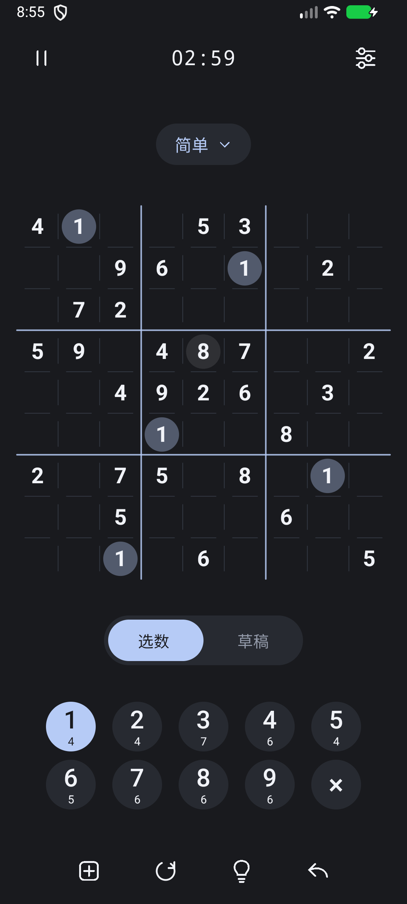
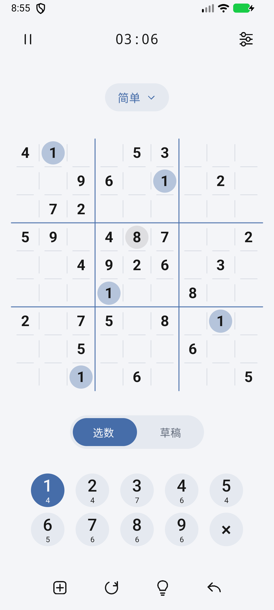
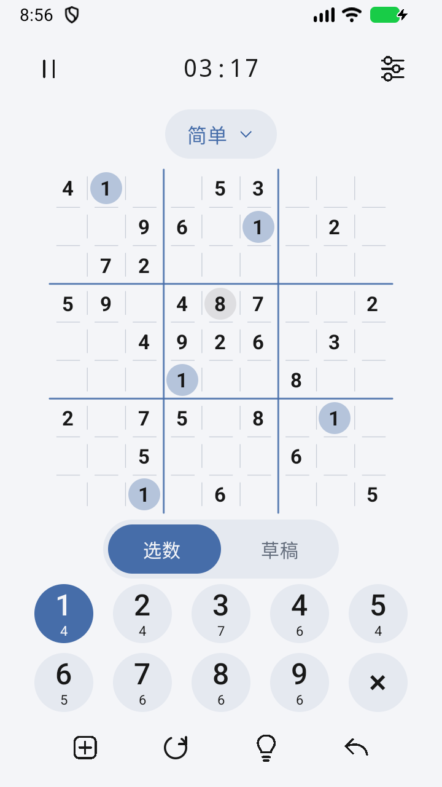

# 静数 · Kotlin + Jetpack Compose

Android 原生数独 App，最低 Android 8.0（API 26）。界面和业务代码全部使用 Kotlin；UI 使用 Compose，不再包含 Java 页面或 Android View 棋盘。无网络权限。

## 安装与升级

当前代码版本 **1.9 / versionCode 10**，本机构建交付文件为 `dist/quiet-sudoku-debug.apk`，APK 不提交到 Git。

已有的 **1.8** 独立签名安装包可从 [GitHub Release](https://github.com/Hanser518/quite_sudoku/releases/tag/v1.8) 下载，该版本不包含 1.9 的通关记录功能。它与本地 Debug 包签名不同，只有相同签名的安装才能覆盖升级。

```sh
adb install -r dist/quiet-sudoku-debug.apk
```

本次为 Debug 签名测试包。包名和签名沿用上一版，可覆盖安装；旧版棋盘、草稿、计时、输入模式和撤销历史继续保留。若旧存档选中了题目数字，会取消该选择；可编辑格的选择继续保留。不要卸载旧版后再安装，否则 Android 会删除本机存档。

存档升级为 v2，额外保存正在查看的单元格；支持读取 v1。1.2 及更早的 App 无法读取 v2 存档。

## 本次调整

- 新增通关记录：在设置或完成弹窗中进入，按难度查看完成日期与用时。记录按完成日期从新到旧排列，每个难度最多保留 20 条；不是按用时排名。同一局撤销后再次完成不重复计入，重开本题或新建对局后可产生新记录。记录保存到本机，升级前已完成的对局因没有完成日期不补录，使用提示完成的对局也会记录。
- 重新校准入门和简单：入门仅需补齐行、列或宫中的最后一个空格；简单只在此基础上增加宫内行列排除。每次挖空后都用这些规则从头完整求解，不允许依靠候选对、候选连锁或试猜通过验证。新规则用于新建对局；重开本题继续使用原题，旧存档继续保留。
- 修复切换数字或取消高亮时先变暗再消失的闪烁：透明端点保留强调色相。数字背景、文字、选中缩放和按压反馈使用临界阻尼弹簧，快速操作时从当前动画位置和速度继续；按压缩放幅度由 9% 缩小为 4%。
- 数字键 1–9 下方显示待填数量：9 减去棋盘中该数字的出现次数，最低为 0。包括题目数字和正式填入的数字，不计草稿，不依赖答案或错误提醒开关。填数、擦除、撤销、提示和重开后自动更新；数量变化有非线性过渡，擦除键不显示数量。
- 未匹配当前数字的 normal 使用中性色低对比圆底（10% 正文色混合棋盘背景）；匹配当前数字的 normal 使用主题强调色背景（36%），输入焦点 active 使用更强的强调色（50%）。切换数字后，旧的同号高亮恢复中性色，其他 normal 保持低调。raw 默认只显示数字。棋盘数字、数字键和键盘焦点均不使用描边，全部通过背景表现状态，并保留非线性过渡。
- 先点棋盘：数字键仅向当前可编辑格输入，继续点击其他格不会自动填入上次数字。点击已有数字只查看；之后可通过数字键修改玩家数字，题目数字始终只读。
- 先点数字区：锁定数字后，点击空格填数；切换数字清除棋盘焦点，不修改刚填的格。再次点已锁定数字退出连续填数。草稿模式遵循相同顺序。
- 点击 raw / normal 进入伪激活：同号数字和数字区对应键显示查看背景；当前输入数字保持不变。单独点击数字键也会激活棋盘同号数字，切换数字切换高亮，再点已锁定数字取消。主动查看棋盘数字时优先显示该数字，取消查看后恢复已锁定数字的高亮。查看不会写入棋盘或生成撤销记录。
- 设置中可开关「错误提醒」，默认开启，选择会保留到下次启动。开启时标记与答案不符的用户填写；关闭时隐藏错误颜色、下划线和无障碍错误描述，不改变填入内容或完成判定。
- 点击空格选中，再次点击取消；取消选择不会重复填入或切换候选。已输入的格仍保留输入焦点，点击该格取消焦点后，再点进入查看状态。
- 行列选区采用连续、淡色的圆角交叉区域：可见时平滑移动；取消时停在当前位置淡出；完全隐藏后重新选择时直接定位到新格再淡入，不从左上角或上次位置扫过。
- 竖屏按可用高度缩小棋盘，数字键盘和底部操作保留在一屏内。横屏采用左右布局。
- 移除了页面上的规则、进度、操作提示、品牌副标题和底部按钮小字。草稿数字和数字键下方的待填数量作为实际对局信息保留。
- 选数/草稿使用滑动选中背景；按压、锁定数字、填数、候选变化、主题、暂停和弹窗均使用 Compose 动画。数字交互和行列位置使用临界阻尼弹簧；其余动画使用 cubic-bezier(0.2, 0, 0, 1)，时长约 100–240 ms，遵循系统动画时长设置。

## 操作

- 顶部：暂停 / 继续、计时、设置；点击难度切换对局。
- 选数：先选格再填数；先点数字或长按数字可锁定后连续填空格，再点锁定数字解除。点击已有数字只查看，不自动覆盖。
- 草稿：每格记录多个候选，再次点数字移除。正式填数会清理同行、列、宫的同号候选。
- 数字键盘中的 × 擦除当前输入格或正在查看的玩家数字，并解除数字锁定；题目数字不可擦除。
- 底部图标依次为新游戏、重开本题、提示、撤销。提示揭示一格答案，最多保留 100 步撤销。
- 后台和手动暂停时不计时。对局与设置自动保存在本机。
- 所有操作保留无障碍描述；错误提醒关闭时，不通过无障碍描述泄露答案错误。

## 截图

| 深色 | 浅色 | 小屏竖向布局 |
| --- | --- | --- |
|  |  |  |

[查看同号数字](docs/screenshots/number-view.png) · [设置](docs/screenshots/settings.png) · [难度选择](docs/screenshots/difficulty.png)

[过渡动画演示](docs/screenshots/transition-demo.mp4)

[1.8 新简单对局示例（45 个已知数）](docs/screenshots/easy-1.8.png)

## 数独逻辑

Sudoku.kt 使用最少候选优先的回溯求解器，最多计数两个解来校验唯一解。完整答案先做数字置换、行带/列栈及其内部的行列置换和转置。入门、简单再随机挖空，每删除一个已知数，就用该档允许的直观规则验证能否完整解出；验证器只根据已填数字重新检查，不保存候选消除，也不使用回溯。困难和 Extreme 继续使用已验证的种子变换。

| 难度 | 已知数 | 逻辑分级 |
| --- | ---: | --- |
| 入门 | 60–64 | 行、列或宫只剩一格时直接补缺 |
| 简单 | 44–48 | 补缺 + 宫内按已知数字进行行列排除，无需记录草稿或猜测 |
| 困难 | 26 | 需要区块排除或裸数对 |
| Extreme | 25 | 超出上述基础逻辑策略 |

入门和简单的空格分布在每次生成时重新随机选择；困难和 Extreme 各保留一个结构种子，变体的解题结构可能重复。旧简单题虽可用完整候选推理解出，但在新标准中归入困难，避免把“候选推理可解”等同于“适合不写草稿”。提示直接揭示答案，不提供推理教程。

参考项目：[LibreSudoku](https://github.com/kaajjo/LibreSudoku)。本项目独立实现，没有复制其代码或资源。

## 构建与验证

环境：JDK 17+（本机为 21）、Android SDK 36、Gradle 8.14.3、AGP 8.13.0、Kotlin 2.2.20、Compose 1.9.0、Material 3 1.3.2。用 Android Studio 打开根目录，配置本机 SDK 路径。

```powershell
.\gradlew.bat :app:assembleDebug :app:engineCheck :app:lintDebug
```

macOS / Linux 使用 ./gradlew。engineCheck 运行 Kotlin/JUnit 单元测试。

构建产物为 app/build/outputs/apk/debug/app-debug.apk；dist 中是本次交付副本，之后修改需重新复制。

连接专用模拟器后运行 Compose 交互测试：

```powershell
.\gradlew.bat :app:connectedDebugAndroidTest
```

测试会清除测试设备上本 App 的对局。12 组核心测试覆盖 400 个随机题目、四档难度、唯一解、草稿清理、撤销、提示、错误开关语义、两种输入顺序、只读查看、数字键高亮及切换、焦点切换、完成判定、损坏存档校验，以及真实 Java v1 存档迁移后原始对局字段和撤销历史的逐字节一致性。入门和简单还由独立的集合实现逐步回放：只能补缺或做宫内排除；同时检查已知数范围，并防止旧简单题再次通过新标准。

12 组 Compose 测试覆盖对局操作、设置持久化、Activity 重建、暂停计时、难度切换、取消确认、重开、全部竖向控件的边界和无滚动布局，并检查模式滑块的非线性位移、深浅主题数字背景的实际像素和明暗区分、数字键触发题目数字和玩家数字的伪激活、同号查看语义、两种输入顺序及查看状态恢复。数量测试覆盖填数、草稿、擦除、撤销、超量填写归零、错误开关和重开，以及数量标签在数字键内的位置。动画回归测试逐帧检查深浅主题快速切换、取消及中途反向操作的亮度范围，以及行列选区的原地淡出和新位置淡入。

1.8 已通过全部 12 组核心测试，以及 Android 16 模拟器常规竖屏（约 393×873 dp）的全部 12 组交互测试，覆盖新难度生成、对局操作和动画回归。1.1 曾在常规竖屏和小屏（360×640 dp）通过当时全部 6 组交互测试，并完成旧 APK 覆盖升级的实际存档校验。

1.9 已通过 14 组单元测试、14 组 Android 16 模拟器交互测试及 lint。新增验证覆盖每档最近 20 条、按完成日期排序、持久化往返与异常数据、通关记录保存、Activity 重建、撤销后再次完成不重复记录、重开计入新记录、难度筛选和滚动到第 20 条。

## 主要文件

- MainActivity.kt：生命周期、计时、设置和存档。
- SudokuScreen.kt：Compose 布局、棋盘、交互动画、弹窗及无障碍语义。
- Game.kt：不可变对局状态、输入、草稿、撤销、提示及 v1 存档兼容。
- Sudoku.kt：规则、求解、唯一解检查、逻辑分级及题目变换。
- GameTest.kt / GameUiTest.kt：核心测试 / Compose 交互测试。
- legacy-v1.txt：由重构前 Java 代码生成的兼容性测试存档。
- Completion.kt / CompletionTest.kt：通关记录、分难度保留上限、排序及持久化校验。

未进行实体设备测试或正式发布签名；本版不包含账号、云同步、广告和排行榜。
